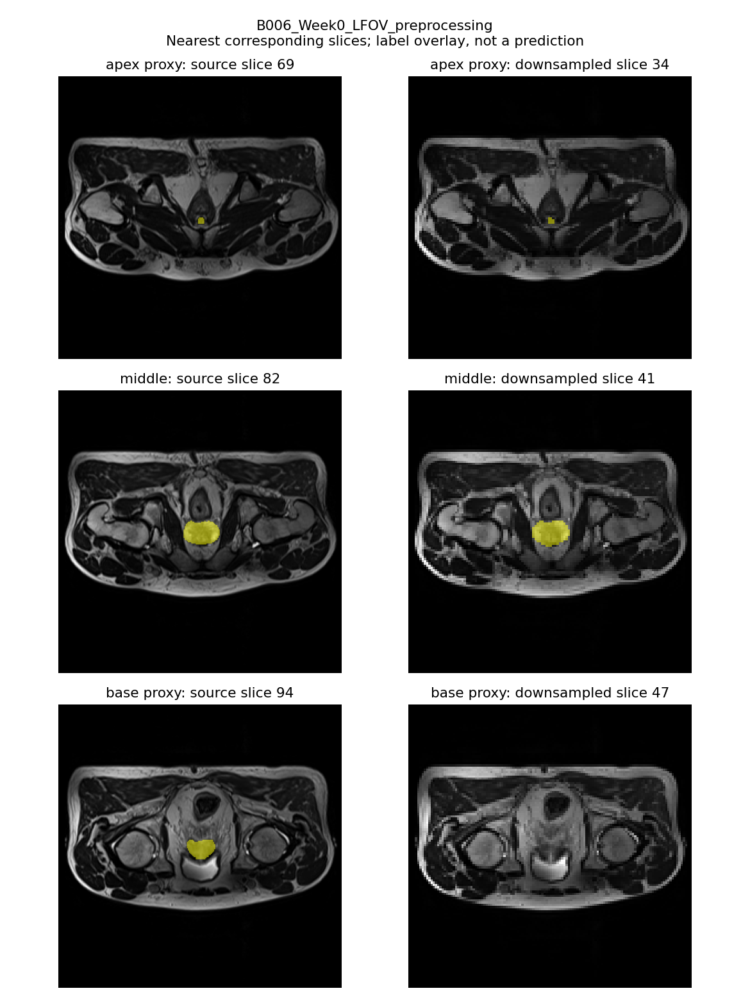
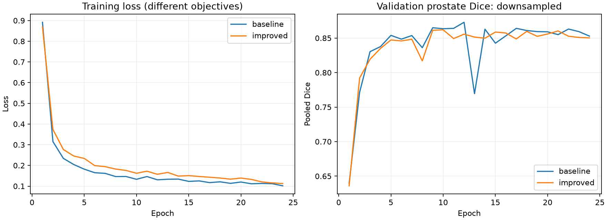
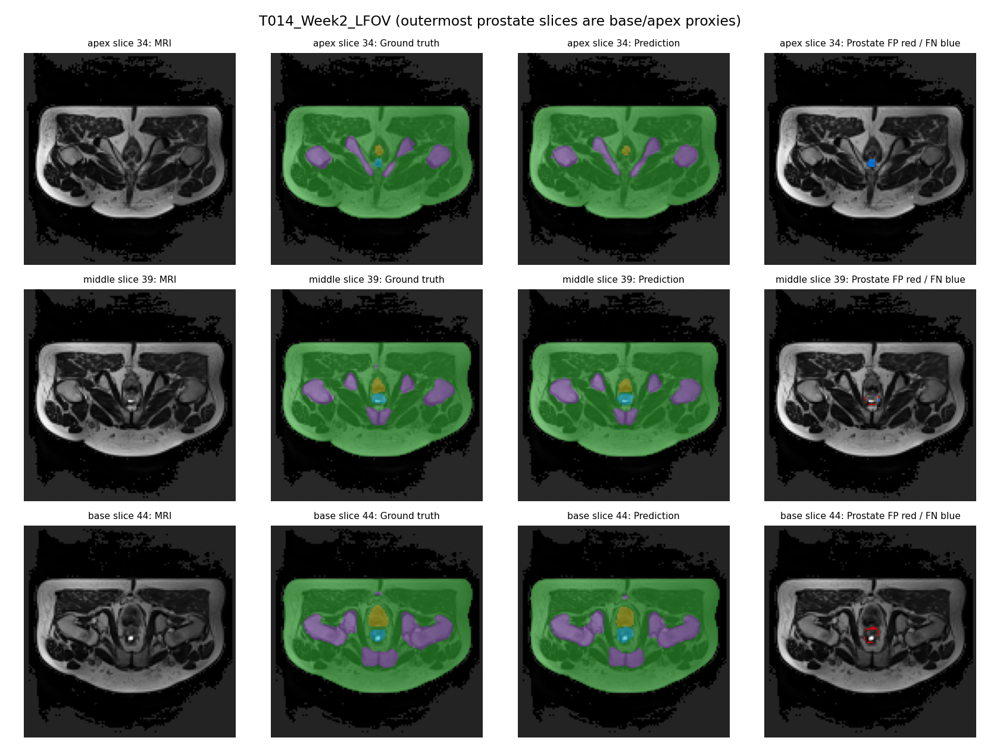
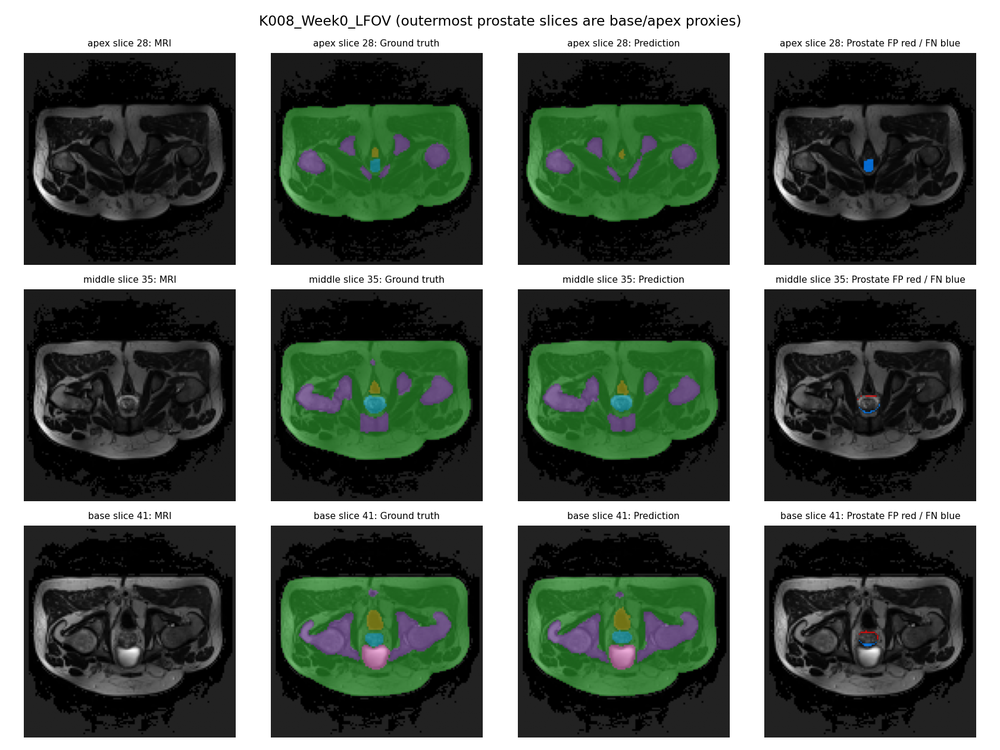
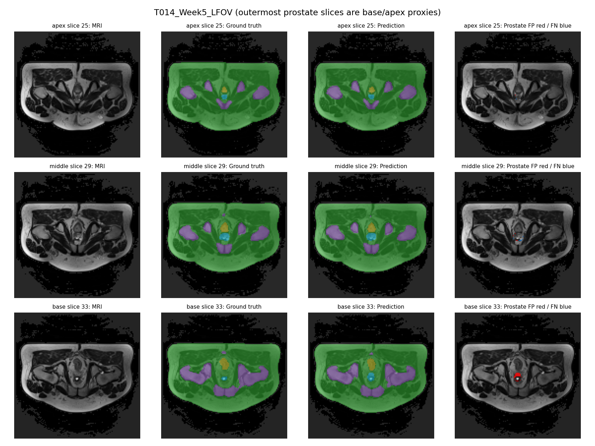

# 3D Improved U-Net for Prostate MRI Segmentation

**COMP3710 Pattern Recognition · Individual Project · Hard Difficulty**  
**Dataset:** HipMRI Study (six-class 3D segmentation)  
**Final evaluation:** half-resolution HipMRI volumes · 24 training epochs per model · NVIDIA L4 · 30 October 2026

**Contents:** [Problem](#1-problem-definition-and-engineering-objective) · [Feasibility review](#2-feasibility-review-compulsory-midpoint-submission) · [Dataset](#3-dataset-and-preprocessing) · [Models](#4-model-architectures-and-learning-objective) · [Experiments](#5-experimental-design-and-reproducibility-controls) · [Results](#6-quantitative-results) · [Failure analysis](#7-qualitative-failure-case-autopsy) · [Recommendation](#8-interpretation-and-engineering-recommendation) · [Limitations](#9-limitations-and-validity-considerations) · [Usage](#10-installation-execution-and-project-structure) · [Verification](#11-evidence-provenance-and-verification-scope) · [AI disclosure](#12-artificial-intelligence-usage-disclosure) · [References](#13-references)

## Abstract

This project investigates whether a residual **3D Improved U-Net with deep supervision** offers a clinically meaningful segmentation advantage over a standard **3D U-Net** for prostate MRI contour drafting. Both PyTorch models segment six labels (0–5), with label 5 representing the prostate, and are trained and evaluated using the same patient-independent HipMRI partitions. To meet the Hard-tier dataset specification, the final experiments use explicitly downsampled three-dimensional volumes, with image–mask alignment and label retention audited before training. Performance is assessed using held-out per-class Sørensen–Dice and Intersection-over-Union (IoU), full-volume failure-case visualisations, parameter count, GPU memory allocation and inference latency.

On 27 test scans from six patients, the standard 3D U-Net achieves **0.8546 pooled prostate Dice**, compared with **0.8525** for the improved model; both exceed the specified **0.70** target. The improved model achieves slightly higher mean per-scan Dice (**0.8494 versus 0.8445**) but has higher measured computational cost. Boundary disagreements remain evident near the terminal annotated prostate slices despite satisfactory global overlap. The evidence therefore supports retaining the lower-cost baseline as the current research reference and prioritising boundary-focused investigation rather than claiming superiority or clinical readiness for the modified architecture.

## 1. Problem definition and engineering objective

Prostate contouring is important to radiotherapy planning: under-contouring may omit tissue intended for treatment, whereas over-contouring can expose adjacent structures unnecessarily. An automated model could reduce manual drafting effort, but clinical utility depends on the *location* of errors, not only their average overlap with a reference mask. Particularly at small superior and inferior prostate cross-sections, a model may obtain a high overall Dice score while producing locally unsuitable contours.

The intended prototype is an **annotation assistant for expert review**, not an autonomous planning or diagnostic system. In line with the COMP3710 project brief, the central engineering question is:

> Does the additional complexity of residual units and deep supervision yield a sufficiently useful improvement in prostate boundaries over a standard 3D U-Net to justify its extra computational cost?

Because **both** compared architectures process 3D volumes, the experiment evaluates *incremental architectural changes within 3D segmentation*; it cannot establish the superiority of 3D over 2D context. As residual units and deep supervision are enabled together, their separate contributions cannot be inferred without ablation experiments.

The project evaluates four practical criteria: (i) prostate Dice at or above 0.70 on the held-out test cohort; (ii) per-class Dice/IoU under identical patient partitions; (iii) examination of 3–5 actual boundary failures; and (iv) runtime and memory costs relevant to a contour-drafting workflow. The original, compulsory midpoint feasibility review is reproduced in the following section.

## 2. Feasibility review (compulsory midpoint submission)

*The following is the full text of the original one-page feasibility review, with only Markdown heading/list formatting applied. It records the initial plan and smoke-test observations, **not** the final experimental results.*

### Feasibility Review: 3D Improved U-Net for Prostate MRI Segmentation

#### User need, scope and acceptance criteria

Develop a Hard-tier 3D Improved U-Net to generate prostate contours from HipMRI volumes for specialist review. Benchmark it against a standard 3D U-Net, focusing on boundary accuracy and computational cost.

#### Acceptance criteria

1.  Target prostate Dice ≥ 0.70 on the held-out test set.

2.  Report prostate and per-class Dice/IoU for both models on identical held-out patients.

3.  Analyse 3–5 failures, including prostate base/apex errors and leakage into nearby organs.

4.  Measure final-model parameter count, peak GPU memory and per-volume inference time.

5.  Confirm patient-independent splits (keeping all visits together) and image–mask alignment.

#### Model choice and course concepts

The task is six-class 3D segmentation (labels 0–5), with prostate label 5 as the primary outcome. A standard 3D U-Net serves as the baseline; the proposed Improved U-Net adds residual blocks and deep supervision. The approach draws on encoder–decoder architectures, multiscale feature extraction, and Dice/cross-entropy losses. Downsampling will be checked to ensure the prostate region is preserved.

#### Preliminary feasibility evidence

Verified 211 paired 3D MRI and segmentation-mask files. One inspected case measured 256 × 256 × 128 voxels, with aligned image/mask affines, six labels (0–5), and 10,198 prostate voxels (label 5). A prostate-centred 64 × 64 × 64 patch retained all prostate voxels. A small residual 3D U-Net prototype with auxiliary deep supervision (90,508 parameters) completed a forward pass, backward pass and optimiser step on an NVIDIA RTX 4070 Laptop GPU. The single-step training loss was finite (2.5241), with a runtime of 0.247 seconds and peak PyTorch-allocated GPU memory of 0.194 GB. These are small-prototype smoke-test measurements, not final-model runtime, memory requirements or accuracy. Ground-truth labels were used to centre the test patch; this is not a deployable inference strategy. Full dataset auditing, patient-independent split verification and segmentation evaluation remain pending; no accuracy results are available.

#### Risks, resources and fallback

Key risks are GPU memory demand, class imbalance, loss of boundary detail during downsampling and patient-level leakage. Training is planned on an A100 with 64 × 64 × 64 patches, batch size 1 and mixed precision; a pilot will establish realistic memory and runtime budgets. Training will mix foreground and background patches, while inference will use overlapping sliding windows without test-mask-guided cropping. Train the standard 3D U-Net baseline first, followed by residual and deep-supervision improvements. If resources are insufficient, reduce patch size or model width, retain the baseline and report any shortfall against the target Dice score.

## 3. Dataset and preprocessing

### 3.1 Dataset and patient-independent partitions

The HipMRI dataset used in this project contains **211 paired MRI volumes and segmentation masks from 38 patients**, including repeat examinations. The six integer labels are indexed 0–5: label 0 denotes background and label 5 denotes the prostate. The anatomical identities of labels 1–4 were not verified from the supplied evidence; they are therefore reported by numerical ID rather than assigned speculative anatomical names.

The split was created at the **patient level**, with every scan from a given patient assigned to exactly one subset. The same frozen assignments were used for both architectures and the earlier original-grid experiments.

| Subset | Patients | MRI volumes | Role |
|:--|--:|--:|:--|
| Training | 26 | 136 | Parameter optimisation and patch sampling |
| Validation | 6 | 48 | Learning-rate scheduling and checkpoint selection |
| Test | 6 | 27 | Final held-out quantitative and qualitative evaluation |
| **Total** | **38** | **211** | |

The random seed was **42**. The test patients were `J026`, `K008`, `S028`, `T009`, `T014` and `V027`. Their labels were not used in training, scheduler updates or checkpoint selection. This prevents direct patient-level leakage between partitions, although scans from the same test patient remain correlated when summarising results.

### 3.2 Spatial downsampling and alignment audit

The original experiments trained on the supplied files without explicit spatial resampling. To satisfy the final assessment specification requiring **downsampled HipMRI 3D data**, the final training and evaluation datasets were prepared by scaling each spatial dimension by **0.5**. This is spatial resampling, rather than simply cropping smaller patches or relying on internal network pooling.

MRI intensities were resampled with **trilinear interpolation**, while segmentation labels were resampled using **nearest-exact interpolation** to avoid interpolating categorical label values. Both used a common voxel-centre grid, with the NIfTI affine adjusted for the new voxel spacing and offset.

| Grid characteristic | Source volumes | Final downsampled volumes |
|:--|:--|:--|
| 210 of 211 scans | 256 × 256 × 128 voxels | 128 × 128 × 64 voxels |
| `K019_Week1` | 256 × 256 × 144 voxels | 128 × 128 × 72 voxels |
| In-plane voxel spacing | 1.40625–1.875 mm | 2.8125–3.75 mm |
| Through-plane spacing | Approximately 1.56 mm | Approximately 3.12 mm |
| Reported orientation | LPS | LPS |

The locally retained preprocessing manifest covers all **211 image–mask pairs** and records source/output file hashes, grid shape, spacing, affine alignment, label sets and prostate voxel counts. According to the recorded audit, all six classes remain present and the image and mask grids remain aligned. The prostate **physical-volume ratio** (after/before resampling) has minimum **0.93835**, median **0.99946** and maximum **1.07241**.

Preserving total volume does **not** guarantee preserving the shape of a narrow boundary. For example, the `B006_Week0` training-patient visualisation indicates loss of prostate voxels near the outermost annotated slice used as a base proxy. Downsampling also changes how much physical anatomy is visible in a fixed 64³ training patch. These effects limit direct interpretation of comparisons between original-grid and downsampled experiments.



*Figure 1. Preprocessing audit example from a training patient. The comparison illustrates how coarse sampling can affect small terminal prostate regions even when aggregate volume is largely preserved.*

### 3.3 Normalisation, sampling and inference preparation

Image intensities are normalised by **z-score statistics over nonzero voxels** in each volume, using the same procedure in training and inference. Before optimisation, the loader checks that MRI and segmentation shapes and affines agree, values are finite and segmentation labels are valid integers in the six-class range.

Each training volume contributes **eight 64 × 64 × 64 patches per epoch**. With probability **0.70**, patch sampling selects a foreground class and a voxel of that class to bias the training data towards labelled anatomy. Remaining sampling attempts draw random spatial patches. An intensity-scaling augmentation is applied during training; left–right flips are omitted to avoid changing potentially side-specific label meaning. Ground-truth-centred patch selection is a **training-only** sampling procedure and is not used to locate anatomy during inference.

Validation and test inference process **complete downsampled volumes** through sliding windows with **50% overlap**, averaging predicted probabilities in overlapping regions. Segmentation masks are accessed for scoring only **after** inference. Predictions retain the grid and affine of the prepared input volume; they are not automatically mapped back to the original-resolution grid.

## 4. Model architectures and learning objective

Both models use a four-level 3D encoder–decoder with skip connections and a base feature width of 16. The baseline uses conventional double-convolution blocks; the improved variant introduces residual convolutional blocks and an auxiliary decoder-supervision pathway. **Group Normalisation** is used for both models because training batches contain one patch, making batch-dependent normalisation less reliable.

| Design component | Baseline: standard 3D U-Net | Proposed: 3D Improved U-Net |
|:--|:--|:--|
| Spatial representation | 3D convolutions and four encoder levels | Same 3D encoder–decoder depth |
| Encoder–decoder skip connections | Yes | Yes |
| Convolutional blocks | Double-convolution blocks | Residual blocks |
| Normalisation | Group Normalisation | Group Normalisation |
| Deep supervision | Not used | Auxiliary decoder output |
| Primary loss | Cross-entropy + foreground soft Dice | Same primary loss |
| Auxiliary loss | None | Weight **0.3** |
| Base feature width | 16 channels | 16 channels |
| Trainable parameters | 1,460,374 | 1,487,820 |

The baseline's main segmentation loss is

$$
\mathcal{L}_{\mathrm{main}}=\mathcal{L}_{\mathrm{CE}}+\mathcal{L}_{\mathrm{Dice,fg}},
$$

where the Dice component is calculated over foreground classes. The improved model additionally minimises

$$
\mathcal{L}_{\mathrm{improved}}=\mathcal{L}_{\mathrm{main}}+0.3\,\mathcal{L}_{\mathrm{aux}}.
$$

Residual connections may facilitate gradient flow, while the auxiliary term supplies supervision to an intermediate decoder output. These are *hypothesised benefits* rather than proof of better boundary predictions. Because the two objectives are different, **raw training losses should not be compared as if they represented the same quantity**; held-out Dice/IoU and qualitative errors are the appropriate performance comparisons. The implementation adapts general 3D U-Net and deep-supervision concepts rather than claiming an exact reproduction of a published network [1, 2].

## 5. Experimental design and reproducibility controls

### 5.1 Final matched training runs

Both final models were trained and evaluated on the explicitly downsampled dataset. The baseline first completed an **epoch-1 pilot**, then resumed the **same** run to 24 total epochs; the improved model began from random initialisation and completed 24 epochs without loading weights from the original-grid experiments. The supplied training histories each contain epochs **1–24**.

| Setting | Value (shared unless specified) |
|:--|:--|
| Dataset | Half-resolution HipMRI; identical frozen patient splits |
| Random seed | 42 |
| Training patches | 64 × 64 × 64 voxels |
| Batch size | 1 |
| Patches per training volume | 8 (1,088 batches/epoch) |
| Optimiser | AdamW |
| Initial learning rate | 0.001 |
| Weight decay | 0.0001 |
| Learning-rate scheduler | ReduceLROnPlateau; validation prostate Dice |
| Precision | Automatic mixed precision (AMP) |
| Data workers | 2 |
| Storage | Local preprocessed-volume cache |
| Validation frequency | Every epoch, on complete validation volumes |
| Sliding-window inference batch | 4 windows |
| Training budget | 24 completed epochs per model |
| Checkpoint selection | Highest validation Dice for prostate label 5 |

The best validation checkpoint occurred at **epoch 12 for baseline** and **epoch 10 for improved**. Random seeds and matching settings improve reproducibility, but GPU kernels are not necessarily bitwise deterministic. Only **one final random seed** was evaluated, so variability across independent training repetitions remains unknown.



*Figure 2. Final downsampled training histories for both architectures. Validation prostate Dice is the meaningful cross-model comparison; the two training losses include different supervision terms.*

### 5.2 Test evaluation and metric definitions

The same **27 test scans from six patients** were used for both final checkpoints. For each class, the reported *pooled* Dice and IoU aggregate predicted/reference voxel counts over all test volumes before computing the score:

$$
\mathrm{Dice}=\frac{2TP}{2TP+FP+FN},\qquad
\mathrm{IoU}=\frac{TP}{TP+FP+FN}.
$$

The **mean per-scan Dice** instead averages individual scan scores, giving each scan equal weight regardless of prostate volume. A class absent from both a prediction and its reference is treated as undefined for that case rather than automatically perfect. The metrics therefore answer slightly different questions: pooled Dice is sensitive to larger total structures, while mean per-scan Dice gives equal influence to small and large scans. Neither is a direct measure of surface distance or clinical boundary safety.

The repeated visits from a given patient are **not independent observations**. Further, the same test cohort was previously inspected in the original-grid experiment. The downsampled rerun was undertaken to satisfy the dataset requirement, and the supplied documentation reports no architecture or hyperparameter search against its test outcomes; nevertheless, this cohort cannot be described as newly untouched.

## 6. Quantitative results

### 6.1 Prostate segmentation and computational cost

| Metric | Baseline 3D U-Net | Improved 3D U-Net |
|:--|--:|--:|
| Best validation prostate Dice | **0.8729** | 0.8620 |
| **Test pooled prostate Dice** | **0.8546** | 0.8525 |
| Test pooled prostate IoU | **0.7461** | 0.7429 |
| **Test mean per-scan prostate Dice** | 0.8445 | **0.8494** |
| Parameter count | **1,460,374** | 1,487,820 |
| Mean test inference time / volume (s) | **0.294** | 0.299 |
| Peak allocated inference GPU memory (GiB) | **0.741** | 0.749 |
| Mean training time / epoch (s) | **20.15** | 25.82 |
| Mean validation time / epoch (s) | **15.46** | 16.10 |
| Mean total time / epoch (s) | **36.00** | 42.29 |

*Table 1. Results from the final half-resolution HipMRI runs. Bold indicates the numerically favourable value for each row, not statistical significance.*

Both models exceed the specified **0.70 pooled prostate Dice target**. The improved network's pooled Dice is lower than the baseline by **0.00210 (0.210 percentage points)**, although its mean per-scan Dice is higher by **0.00492 (0.492 percentage points)**. Improved scores are higher on **16 of 27 scans** but only **three of six patient-level means**. These results are compatible because pooled and scan-averaged metrics weight cases differently; they do not demonstrate a consistent patient-level improvement.

All evaluated scans exceed Dice 0.70 in the reported outputs, with worst-case scan Dice **0.7386** for baseline and **0.7591** for improved. That higher improved minimum is potentially useful to investigate, but the limited patient cohort does not establish robust worst-case improvement. In particular, a globally acceptable Dice score can still coexist with anatomically consequential local errors.

The improved model has **27,446 more parameters** (approximately **1.9%**), while its measured training time is approximately **28.1%** higher per epoch and its total epoch time approximately **17.5%** higher. Mean inference time rises from 0.294 to 0.299 seconds per volume (approximately **2%** using rounded values). Thus the additional training cost is more pronounced than the parameter-count difference alone would suggest.

Both final runs were recorded on an **NVIDIA L4**. Training and validation timings are averages over the 24 completed epochs, excluding one-time cache creation. Inference timing covers warmed full-volume prediction and CPU-side overlap aggregation but excludes NIfTI file loading and plotting. The memory numbers represent **peak PyTorch-allocated GPU memory**, not whole-device consumption. They are single-run observations, not controlled hardware microbenchmarks.

### 6.2 Per-class pooled segmentation metrics

| Label | Baseline Dice | Improved Dice | Baseline IoU | Improved IoU |
|:--|--:|--:|--:|--:|
| 0 — background | 0.9979 | 0.9981 | 0.9957 | 0.9963 |
| 1 | 0.9873 | 0.9877 | 0.9748 | 0.9756 |
| 2 | 0.9252 | 0.9254 | 0.8608 | 0.8612 |
| 3 | 0.9568 | 0.9568 | 0.9171 | 0.9172 |
| 4 | 0.8717 | 0.8618 | 0.7726 | 0.7571 |
| **5 — prostate** | **0.8546** | **0.8525** | **0.7461** | **0.7429** |

*Table 2. Held-out pooled Dice and IoU for every segmentation label, calculated on the same test patients. Labels 1–4 retain numerical IDs because their anatomical mapping was not independently confirmed.*

Differences for labels 0–3 are negligible at the precision reported, whereas the improved model performs worse on label 4 and slightly worse on the primary prostate label 5 in pooled overlap. The very high background score is expected to dominate when background voxels are numerous and should not be treated as evidence of safe prostate boundaries.

## 7. Qualitative failure-case autopsy

The five lowest prostate-Dice scans from the **improved final model** are examined below. Four belong to patient `T014` at different visits and one belongs to `K008`: they are five **scans**, but only two **independent patients**. Each exported panel contains the MRI, ground-truth segmentation, predicted segmentation and an error overlay. **Red denotes false-positive prostate voxels** (predicted but not annotated); **blue denotes false negatives** (annotated but missed).

Slices described as *base* or *apex* are operational proxies based on the outermost annotated prostate slices along the relevant axis, **not** anatomical landmarks verified by a radiologist.

| Improved-model test scan | Prostate Dice | Evidence from the exported comparison panel |
|:--|--:|:--|
| [`T014_Week3`](figures/T014_Week3_failure.png) | **0.7591** | Smaller apex/middle boundary disagreements; both excessive and missing voxels around the base. |
| [`T014_Week2`](figures/T014_Week2_failure.png) | **0.7657** | Prostate absent from the displayed apex prediction; mixed base/middle boundary differences, including false positives. |
| [`K008_Week0`](figures/K008_Week0_failure.png) | **0.7732** | Displayed apex prostate missed; opposing false-positive/false-negative boundary arcs at central and base slices. |
| [`T014_Week1`](figures/T014_Week1_failure.png) | **0.8134** | Apex under-segmentation and base over-segmentation; smaller discrepancies centrally. |
| [`T014_Week5`](figures/T014_Week5_failure.png) | **0.8150** | Modest apex/middle errors and a notable false-positive region around the small base target. |



*Figure 3. `T014_Week2`: missing prostate at the displayed terminal slice and mixed boundary errors elsewhere. The approximately 0.77 scan Dice does not describe where these errors occur.*



*Figure 4. `K008_Week0`: another patient with terminal-slice omission and competing false-positive/false-negative contour errors.*



*Figure 5. `T014_Week5`: incorrect positive voxels are conspicuous around a small base-region contour.*

These examples illustrate **two recurrent failure patterns**: (1) missing small terminal prostate regions, and (2) extending predicted contours outside annotated boundaries. Small target size and weak image contrast are plausible contributors, but the displayed panels do not establish a causal explanation. They also **do not establish leakage into a specific neighbouring organ**, so no such claim is made. The baseline's lowest-scoring scan is `T014_Week2`; its other evaluation outputs are retained locally rather than included in the code submission.

The concentration of four difficult visits in patient `T014` may indicate persistent case-specific difficulty; it must not be mistaken for evidence of four independent failure mechanisms. A specialist would still need to review and correct these contours before any clinical use. For stronger diagnosis, future experiments should quantify slice-wise Dice and physical surface distances, relate errors to anatomy verified by an expert, and inspect patient-level rather than merely scan-level performance.

## 8. Interpretation and engineering recommendation

**Recommendation: retain the standard 3D U-Net as the preferred research baseline at present; do not advance either model to autonomous clinical contouring.** The residual/deep-supervised variant does not demonstrate a decisive advantage: baseline achieves marginally higher pooled prostate Dice, lower parameter count, faster training and slightly faster full-volume inference. The improved model shows a small gain in mean per-scan Dice and a higher observed minimum, but only three of six patient-level means improve. The trade-off does not currently justify the additional training cost for this research prototype.

The **practical boundary limitation** is more consequential than the small aggregate difference. The terminal-slice errors shown above demonstrate that passing a global Dice target is insufficient to certify clinically useful contours. For an expert-in-the-loop annotation tool, predictions should therefore be presented as **editable drafts requiring complete specialist review**, with particular scrutiny of small base/apex regions. This is a proposed operating safeguard, not a validated clinical threshold or proof of safety.

The next controlled research steps are to (i) measure slice-wise Dice and physical surface distances, including 95th-percentile Hausdorff distance where spacing permits; (ii) test residual blocks and deep supervision separately with matched training budgets; (iii) repeat training with multiple random seeds and evaluate per-patient variability; and (iv) obtain a new independent patient cohort for final assessment. Any boundary-specific augmentation, loss change or patch-sampling adjustment should be selected using training/validation patients, **not optimised to these already inspected test failures**.

### 8.1 Historical original-grid experiments (not final assessment results)

Earlier original-grid experiments, run on a reported **A100**, yielded pooled test prostate Dice of **0.8341 (baseline)** and **0.8375 (improved)**. Both logged 24 epochs, although the original baseline configuration requested 100. Their best validation epochs were 18 and 21 respectively. These historical results are retained locally for provenance only and are not part of the code submission.

They should **not** be interpreted as a controlled downsampling ablation. Between the historical and final experiments, the label grids, physical coverage per patch and GPU hardware changed, and the same test patients were evaluated again. The final conclusions in this README therefore use the **downsampled L4 runs**, not the original-grid results.

## 9. Limitations and validity considerations

The primary limitations are the **small independent test cohort** (six patients), correlated repeat visits, **one final seed per architecture**, and non-independent reuse of the original test patients after resampling. As residual blocks and deep supervision were changed together, their individual effects are confounded. No 2D comparator was trained, so the broader benefit of volumetric context is outside the experimental design.

Downsampling preserves overall field of view but reduces fine boundary detail; evaluations against **downsampled reference masks** do not directly quantify accuracy against original-resolution radiotherapy contours. Inference benchmarks omit data loading and visualisation, and peak allocated memory underestimates total runtime/device footprint. No expert-verified organ-leakage audit, calibrated clinical acceptance threshold or external validation study was performed. These constraints limit claims of clinical safety, generalisability and deployment readiness.

## 10. Installation, execution and project structure

### 10.1 Software environment

The supplied pre-training and pre-evaluation environment snapshots report the following configuration for the final experiments:

| Software / hardware | Recorded version or device |
|:--|:--|
| GPU | NVIDIA L4 |
| Python | 3.13.16 |
| PyTorch | 2.11.0+cu130 |
| CUDA | 13.0 |
| cuDNN | 92700 (reported version code) |
| NumPy | 2.1.3 |
| NiBabel | 5.4.2 |
| Matplotlib | 3.10.0 |

Full package/environment snapshots and code hashes are retained locally; the exact direct dependency versions needed for this pipeline are recorded above and in `requirements-colab.txt`. A separate earlier **T4** preprocessing snapshot is not evidence of the hardware used in the final model runs. Install the packages from `requirements.txt` or use `requirements-colab.txt` and the recorded environment for closer reproduction; select a PyTorch build compatible with the available CUDA driver. Reproduction across different hardware/software environments may produce small numerical differences.

The mandatory model and dataset implementation files are `modules.py`, `dataset.py`, `train.py`, `predict.py` and this `README.md`. The workflow also uses `create_split.py` to regenerate the seed-42 reference assignments, `prepare_3d.py` for downsampling, `evaluate_3d.py` for held-out evaluation, and smoke/integration/AMP/cache verification scripts. The Colab workflow is provided in [`colab_downsampled.ipynb`](colab_downsampled.ipynb). `predict.py` must be present during training because validation imports its sliding-window implementation.

**Data and checkpoints are not committed to the course repository.** The code repository should contain the source, the seven visual report figures in `figures/`, not raw MRI datasets, caches, environments or trained weight files. Model checkpoints must be retained separately if continued inference is required.

For Colab, upload the project Python scripts to the Drive code folder, open the notebook, select a GPU and edit its code/data/output paths. The notebook copies the source dataset, generates a reference split if no archived split is available, downsamples, checks hashes/grids and displays training-only panels. Run the baseline epoch-1 pilot, continue it to 24 total epochs, then run improved and evaluate both best-validation checkpoints. Inspect the preprocessing panels before training. A fresh runtime must have the packages from `requirements.txt` installed before running the notebook. The final download cell creates a local evidence archive; these generated exports are not intended for Git.

### 10.2 Prepare and validate the half-resolution dataset

Run the following commands from the project implementation directory, supplying paths appropriate to the local or Colab environment:

```bash
python create_split.py --data-root HipMRI_Study_open --output runs/reference_split.json
python prepare_3d.py \
  --data-root HipMRI_Study_open \
  --output-root data_downsampled \
  --scale 0.5 \
  --reference-split runs/reference_split.json

python train.py --check-data --data-root data_downsampled
python smoke_test_3d.py --data-root data_downsampled
python test_training_3d.py
```

The generated reference uses the same sorted patient discovery, seed 42 and 15% validation/test fractions as training. On the complete 211-scan dataset it reproduces the reported 26/6/6 patient partitions. Both architectures must use that same dataset and seed. `--reference-split` verifies preparation against these assignments and selects preprocessing panels from training patients only; it does not override the training split algorithm. The audits should confirm MRI/mask pairing, matching grids and affines, valid labels, retained prostate voxels and expected patient partitions before full training. The source data should remain unchanged.

### 10.3 Train both architectures

For a new matched experiment, train each model against the same prepared root and settings:

```bash
python train.py \
  --architecture baseline \
  --data-root data_downsampled \
  --output-dir runs/baseline_downsampled \
  --device cuda --epochs 24 \
  --patch-size 64 64 64 --batch-size 1 \
  --patches-per-volume 8 --base-channels 16 \
  --workers 2 --seed 42 --val-every 1 \
  --cache-dir hipmri_cache/downsampled \
  --window-batch-size 4 --profile

python train.py \
  --architecture improved \
  --data-root data_downsampled \
  --output-dir runs/improved_downsampled \
  --device cuda --epochs 24 \
  --patch-size 64 64 64 --batch-size 1 \
  --patches-per-volume 8 --base-channels 16 \
  --workers 2 --seed 42 --val-every 1 \
  --cache-dir hipmri_cache/downsampled \
  --window-batch-size 4 --profile
```

When resuming an interrupted run, add `--resume <run_dir>/last.pt` and preserve the original options. The `--epochs` argument is the **total target number** of epochs, not the number to add. Saved outputs include `config.json`, `split.json`, `metrics.csv`, `performance.csv`, loss/validation curves, and `best.pt`/`last.pt` checkpoints. For the final Colab runs, the baseline's initial one-epoch pilot was continued rather than restarted; the improved run started anew.

### 10.4 Predict and evaluate

A prediction on a **prepared downsampled image** can be generated using:

```bash
python predict.py \
  --checkpoint runs/improved_downsampled/best.pt \
  --image data_downsampled/semantic_MRs/J026_Week0_LFOV.nii.gz \
  --output predictions/J026_Week0.nii.gz \
  --device cuda --window-batch-size 4
```

Predictions are written as NIfTI masks on the supplied grid, along with voxel-count output and an overlay image. An optional `--mask` argument supports comparison with a known reference **after** prediction, without guiding the inference. The script does not automatically resample arbitrary original-resolution scans or inverse-transform predictions to a different grid.

To evaluate the frozen test subset of the saved checkpoints:

```bash
python evaluate_3d.py \
  --checkpoint runs/baseline_downsampled/best.pt \
  --output-dir runs/baseline_downsampled/test_final \
  --data-root data_downsampled \
  --device cuda --window-batch-size 4 --failure-cases 5

python evaluate_3d.py \
  --checkpoint runs/improved_downsampled/best.pt \
  --output-dir runs/improved_downsampled/test_final \
  --data-root data_downsampled \
  --device cuda --window-batch-size 4 --failure-cases 5
```

An equivalent test-evaluation entry point is available through `train.py --evaluate-only` with `--resume` and `--evaluation-output`. Test evaluation uses the patient assignments stored in the checkpoint and does not alter the model. For HPC execution, prepare the dataset first and explicitly set `DATA_ROOT` to its downsampled directory when submitting `train_rangpur.sh` (for example, `DATA_ROOT=/path/to/data_downsampled sbatch train_rangpur.sh baseline --epochs 24 --window-batch-size 4 --profile`). Run compute work on allocated nodes, not the shared login node; **the final measurements reported here are from Colab**, not Rangpur.

## 11. Evidence provenance and verification scope

Supporting numerical exports, patient assignments, preprocessing audits and environment snapshots are retained locally, outside the submitted Git history. The final numerical tables and seven report figures are included directly in this submission. The supplied report describes checks of consecutive 24-epoch histories, matching split files, 27 corresponding test-case records per model, recomputed mean per-case Dice and consistent recorded software/code metadata. The locally retained archive provenance records a SHA-256 identifier for the evidence bundle. Local synthetic checks covered both architectures, resume/checkpoint compatibility, mask-independent inference, metric arithmetic, AMP overflow handling, cache/batched-window equivalence, spatial alignment and rejection of disappearing labels. These are distinct from the student-run Colab experiments reported above.

**Verification boundary:** the pooled metrics are taken from the supplied evaluation summaries. The raw trained checkpoints and prediction volumes were not available to the earlier documentation audit for an independent inference rerun or pooled-voxel recount. Best-epoch values are supported by recorded logs, but the exported scores cannot be independently tied to checkpoint file hashes from the evidence described. Statements about completed runs and checks in this README therefore refer to the **recorded experimental artefacts**, not to a new independent GPU replication performed for this report.

Before submitting, ensure that the **relative figure/table paths resolve in the GitHub pull request** and render in the Markdown-to-PDF export. A figure that exists only in a local Colab Drive folder is not part of the submitted README.

## 12. Artificial Intelligence Usage Disclosure

OpenAI **Codex** was used to assist with implementation and refactoring of the model, data pipeline, training, checkpointing, inference, evaluation and testing scripts; preparation of the downsampling workflow and provenance records; Colab notebook organisation; and technical report drafting. OpenAI **ChatGPT** assisted with report structure, editorial revision and interpretation of the documented requirements. The final Colab experiments and their outputs were supplied by the student; the numerical scores in this report were not generated as illustrative AI estimates.

AI-assisted verification included checks described in the project evidence, such as patient-level separation, preprocessing records, training history continuity, per-case summary consistency and generation of comparison panels. These checks do **not** substitute for understanding the implementation or for independent clinical validation. The student remains responsible for inspecting the code, confirming the reported results and explaining design decisions, limitations and AI assistance during assessment. Relevant AI prompt history or conversation evidence should be retained for course review as required by the assessment policy.

## 13. References

1. Ö. Çiçek, A. Abdulkadir, S. S. Lienkamp, T. Brox and O. Ronneberger, “3D U-Net: Learning Dense Volumetric Segmentation from Sparse Annotation,” *Proceedings of MICCAI*, 2016, pp. 424–432.
2. F. Isensee, P. Kickingereder, W. Wick, M. Bendszus and K. H. Maier-Hein, “Brain Tumor Segmentation and Radiomics Survival Prediction: Contribution to the BRATS 2017 Challenge,” *Brainlesion*, 2018, pp. 287–297.
3. COMP3710/COMP7710 Course Teaching Team, *Pattern Recognition: Working Prototype Project in the Era of Artificial Intelligence*, Final Assessment Specification, version 2.4, Semester 2, 2026, especially §§2.2, 3, 4, 5.3 and 6.1.
4. COMP3710 Course Teaching Team, *Getting Started on Rangpur*, Semester 2, 2026.
